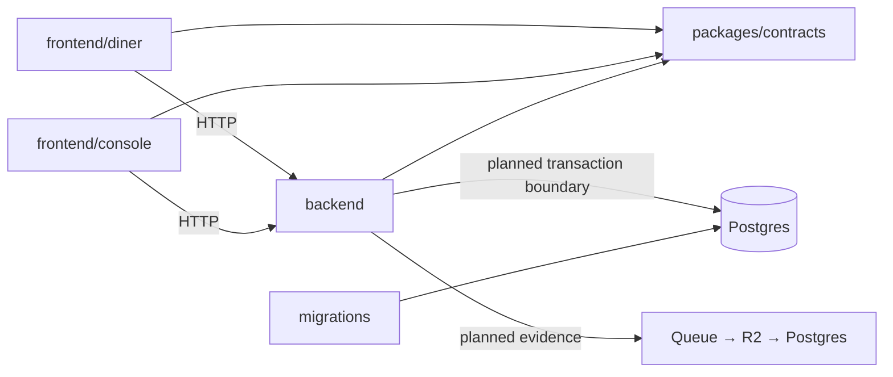

# Architecture

Baseline: [Claude's final V1 plan](https://claude.ai/artifact/LUJ4ggBXpF7korJWbg4u8f), reviewed October 13, 2026. **3D is the hook. The loop is the product.** Accepted decisions are indexed in [ADRs](adr/README.md); implementation progress is explicit in [delivery](delivery.md).

## Module boundaries

One repository, separate build targets. The diner is static TypeScript/Vite; the staff console is React/Vite. Hono runs the API on Workers. Shared contracts contain serializable schemas, not database clients, UI or Three.js objects. SQL migrations own database changes. Add backend modules `content`, `publication`, `intent`, `orders`, `experiments` only as each feature arrives; a future-folder forest adds no value.

## Two kinds of events

**Domain events** are accepted business facts. Dish revisions, approvals, publication, availability and experiments are selective event-sourced streams in Postgres. A command checks authority and expected version, then atomically appends facts, updates live projections, records the command result and queues outbox work. Replay rebuilds projections without external side effects.

**Intent observations** record what the diner app observed. The planned flow is phone outbox → ingest Worker → Queue receipt → create-only R2 archive → deduplicated Postgres rows → queue acknowledgement. No receipt before Queue acceptance; delete only acknowledged event IDs locally. These observations rebuild metrics, not business state.

The exposure contract pins the publication, dish revision, actual tier, renderer/manifest version, availability version and experiment assignment. A server-side temporal query describes the committed menu state. It cannot prove a cached/offline client displayed that state; use its pinned exposure record.

## Visuals and analysis

T0 is a complete photo/text menu. T1 is shallow parallax using reviewed cutouts. T2 separates captured plating stages with limited viewpoints and a fallback. Three.js is loaded only after a tap behind `mount / update / dispose`; T3/AR is deferred. Size references must come from measured captures.

A redeem code links a browsing session to a POS ticket, not to an individual's thoughts. Unlinked means unknown. Initial readouts show sample units, linkage coverage, suppressed small cells and directional uncertainty. Owner changes are tested with a frozen blocked-switchback plan.

## Foundation boundary

Current code has shells, health response and initial dish-event validation. Migrations establish private storage constraints; no domain write API or production role grants exist yet. Queue/R2/Hyperdrive and staff authentication are not silently mocked or configured with invented IDs. [PR sequencing](delivery.md) supplies the next complete slices.
