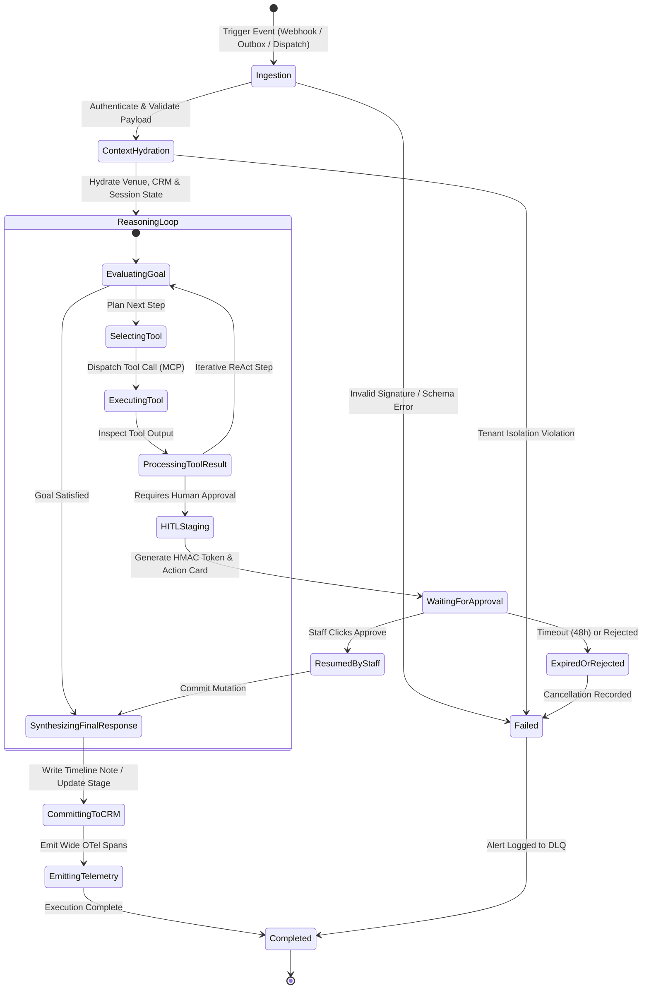
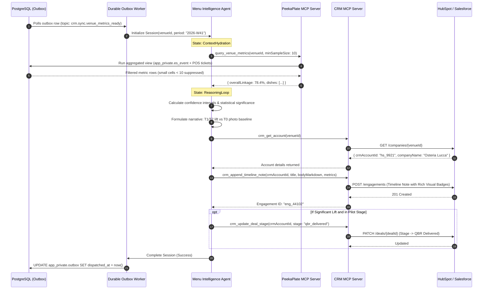
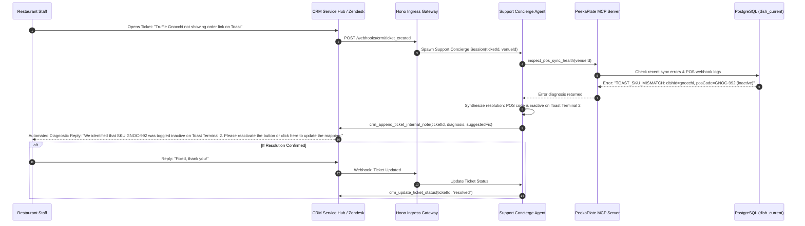

# Agent Workflows and State Machines

> **Module:** `crm-agentic-architecture` · **Status:** Specification
>
> This document details the execution lifecycles, state transitions, and step-by-step sequence flows for the three core autonomous agent workflows connecting PeekaPlate to the CRM platform.

---

## 1. Universal Agent State Machine

All specialized agents (Onboarding, Intelligence, Support Concierge) follow a unified, deterministic state machine implemented on top of a durable execution runtime.



### State Definitions

1. **`Ingestion`**: Receives an event from the PostgreSQL Outbox, an inbound CRM webhook, or a staff dispatch. Verifies cryptographic signatures and checks that `venue_id` is well-formed.
2. **`ContextHydration`**: Queries read-only views for active restaurant configuration and CRM mappings. Enforces ADR 0005: `app.tenant_id` is locked to the single venue.
3. **`ReasoningLoop` (ReAct)**: The agent formulates a plan, selects MCP tools, executes tool calls, observes outputs, and loops until the goal is achieved or a Human-in-the-Loop boundary is reached.
4. **`HITLStaging`**: Any action involving menu mutation, price change, or commercial status transition freezes execution, emits an HMAC-signed approval token, and suspends the workflow.
5. **`CommittingToCRM`**: Upon success (or staff approval), final summary artifacts and state updates are written to the CRM via the CRM MCP Server.
6. **`EmittingTelemetry`**: Comprehensive wide events (prompts, tool durations, token usage, evaluation tags) are emitted to OpenTelemetry.

---

## 2. Workflow A: Menu Performance Intelligence & QBR Generation

**Trigger:** The PostgreSQL transactional outbox emits `crm.sync.venue_metrics_ready` following the completion of an empirical switchback block or weekly batch aggregation.



### Execution Steps
1. **Outbox Ingestion:** The outbox processor reads an undispatched `crm.sync.venue_metrics_ready` row from `app_private.outbox`.
2. **Data Hydration with Privacy Guard:** The agent requests metrics via `query_venue_metrics`. The query layer enforces differential privacy by omitting dish observation groups with $<10$ visits to prevent deanonymizing individual diners ([ADR 0006](../adr/0006-orders-and-measurement.md)).
3. **Statistical Reasoning:** The LLM evaluates conversion rates:
   $$\text{Lift} = \frac{\text{Conversion}_{\text{Enhanced}} - \text{Conversion}_{\text{Baseline}}}{\text{Conversion}_{\text{Baseline}}}$$
   The agent checks whether the $95\%$ confidence interval excludes zero. It explicitly notes directional uncertainty if sample volume is moderate.
4. **CRM Timeline Append:** The agent generates a structured executive briefing in markdown and logs it to the CRM Company record.
5. **Idempotent Outbox Ack:** The outbox worker stamps `dispatched_at = now()` inside a database transaction, guaranteeing at-least-once delivery with idempotent execution.

---

## 3. Workflow B: Autonomous Restaurant Lead Onboarding & Menu Digitization

**Trigger:** A restaurant owner submits an onboarding inquiry or email with a menu attachment, or a sales representative moves a CRM deal to `Discovery`.

```mermaid
sequenceDiagram
    autonumber
    participant Prospect as Restaurant Owner / GM
    participant Ingress as Hono Ingress Gateway
    participant Router as Supervisor / Router
    participant Agent as Onboarding Agent
    participant CMCP as CRM MCP Server
    participant PMCP as PeekaPlate MCP Server
    participant CRM as CRM Platform

    Prospect->>Ingress: POST /webhooks/onboarding (Menu PDF + Venue Info)
    Ingress->>Ingress: Verify signature & sanitize inputs
    Ingress->>Router: RouteEvent("onboarding", payload)
    
    Router->>Agent: Spawn Onboarding Agent Session
    
    Agent->>Agent: Parse menu text; extract dish names, descriptions, allergens
    Agent->>PMCP: inspect_pos_compatibility(posProvider: "toast")
    PMCP-->>Agent: { compatible: true, webhookSupport: true, requiredFields: [...] }
    
    Agent->>CMCP: crm_search_accounts(name: "Trattoria Romana")
    alt Account Does Not Exist
        Agent->>CMCP: crm_create_account(companyName, address, posProvider)
        CMCP->>CRM: POST /companies
        CRM-->>CMCP: crmAccountId: "hs_88192"
    end
    
    Agent->>CMCP: crm_update_deal_stage(crmAccountId, stage: "menu_digitized")
    CMCP->>CRM: Update Deal Stage
    
    loop For Each Extracted Dish
        Agent->>PMCP: stage_dish_revision_draft(venueId, dishName, desc, expectedVersion: 0)
        PMCP-->>Agent: { proposalId, hmacToken, reviewUrl }
    end
    
    Agent->>CMCP: crm_append_timeline_note(crmAccountId, "Onboarding Audit Complete", menuDigestUrl)
    CMCP->>CRM: Log Engagement
    
    Agent-->>Prospect: Email/Console Notification with One-Click Menu Review Link
```

### Execution Steps
1. **Intake & Sanitization:** Ingest gateway strips tracking pixels, validates mime-types (PDF, images, plain text), and passes raw menu assets to the Onboarding Agent.
2. **Entity Extraction:** The LLM parses dish candidates, matching them against PeekaPlate's strict schema (`name` min 1 max 160 chars, `description` max 4000 chars, no NUL bytes).
3. **POS Diagnostic Check:** Queries the POS capability catalog to confirm whether the restaurant's POS system supports real-time redeem code linking.
4. **CRM Pipeline Advancement:** Updates the CRM Deal to `menu_digitized` and logs the menu structure into the CRM Company timeline.
5. **Staged Proposals:** Generates draft dish revisions in `pending_human_review` status. The restaurant manager receives an approval link; no changes go live to diners without staff confirmation.

---

## 4. Workflow C: Support & POS Error Triage Concierge

**Trigger:** An operational failure occurs (e.g., POS ticket redemption fails, or a staff member opens a support ticket in HubSpot Service Hub).



### Execution Steps
1. **Ticket Ingestion:** Incoming webhook from CRM Service Hub triggers the Support Concierge Agent.
2. **Automated Diagnostic Scan:** The agent calls `inspect_pos_sync_health` to retrieve the last 24 hours of POS integration logs, failed webhook receipts, and unlinked ticket exceptions.
3. **Root Cause Analysis:** The agent correlates the restaurant's error message with known error patterns (e.g., SKU mismatch, expired OAuth token, terminal offline).
4. **Resolution Dispatch:** Posts an internal diagnostic report for PeekaPlate support staff and drafts a courteous, actionable troubleshooting guide for the restaurant manager.
5. **Auto-Resolution:** Once confirmed by staff or verified by the health check, the CRM ticket is transitioned to `resolved`.

---

## 5. Failure Handling, Dead-Letter Queues, and Recovery

1. **Transient Network or Rate Limit Failures:**
   - The MCP client wraps tool calls with exponential backoff ($2^n \times 500\,\text{ms}$, max 3 retries).
   - If the CRM API returns HTTP 429, the agent pauses execution until the `Retry-After` epoch expires.
2. **Context Window Overflow:**
   - If historical CRM engagement history exceeds model context limits ($128\text{k}$ tokens), a summarization pre-pass compresses older timeline notes before prompt assembly.
3. **Dead-Letter Queue (DLQ):**
   - Workflows failing three consecutive attempts are written to `app_private.crm_agent_dlq` with full execution traces.
   - An alert is dispatched to the engineering on-call channel with the `X-Agent-Trace-ID`.
