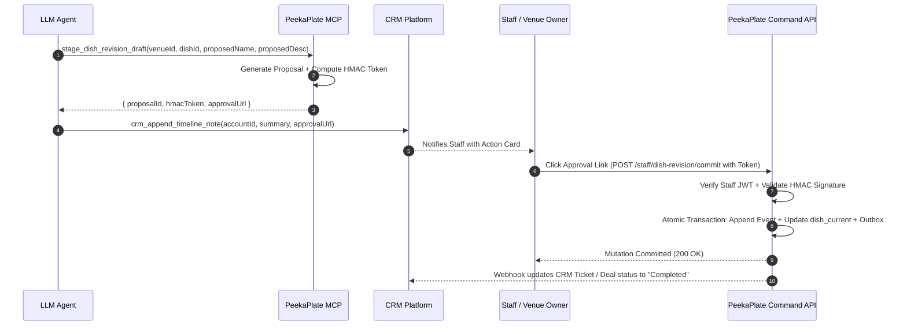

# Agentic Architecture Specification: Connecting LLMs to CRM Systems

> **System Thesis:** *3D is the hook. The loop is the product.* 
> PeekaPlate measures the link between diner menu exposure and actual POS ticket outcomes. The Agentic CRM Architecture bridges this empirical measurement engine with commercial CRM platforms (HubSpot, Salesforce, Attio), giving restaurant operators, sales representatives, and support engineers proactive, autonomous intelligence while enforcing strict multi-tenant boundaries and diner privacy.

---

## 1. Executive Summary and Problem Statement

### 1.1 The Operational Bottleneck
Connecting restaurant operators to a high-technology measurement platform involves continuous friction across three operational phases:
1. **Sales & Onboarding:** Processing unstructured menu PDFs, extracting dish entities, auditing visual capture feasibility (T0 photo, T1 cutout, T2 staging), and verifying POS system compatibility (Toast, Square, Clover, Aloha, Lightspeed).
2. **Menu Engineering & Performance Reporting:** Extracting selective event-sourced PostgreSQL metrics (dish exposure vs. ticket redemption lift, switchback experiment conclusions) and translating them into digestible executive summaries and Quarterly Business Review (QBR) reports for restaurant owners.
3. **Technical Support & POS Concierge:** Triaging broken POS webhooks, invalid dish identifiers, out-of-sync menu prices, and dining room operational errors.

Static point-to-point integration tools (e.g., Zapier, static webhook webhooks) fail because restaurant data is inherently semi-structured, operational workflows require contextual judgment, and raw data queries lack domain reasoning.

### 1.2 The Agentic Solution
An **Agentic Architecture** deploys autonomous, tool-augmented Large Language Models (LLMs) executing iterative reasoning loops (Plan $\to$ Tool Call $\to$ Observe $\to$ Synthesize). By interfacing with CRM platforms through the **Model Context Protocol (MCP)**, agents safely inspect, enrich, update, and resolve customer and venue lifecycles.

```
┌─────────────────────────────────────────────────────────────────────────────┐
│                             EXTERNAL TOUCHPOINTS                            │
│    Restaurant Owners       Prospective Leads       Support Tickets / POS   │
└──────────────┬─────────────────────┬───────────────────────────┬────────────┘
               │ (Console / Email)   │ (Web Form / Inbound)      │ (Webhooks)
               ▼                     ▼                           ▼
┌─────────────────────────────────────────────────────────────────────────────┐
│                    HONO EDGE GATEWAY (Cloudflare Workers)                   │
│   • HMAC Webhook Verification   • Rate Limiting   • Tenant Context Auth     │
└──────────────────────────────────────┬──────────────────────────────────────┘
                                       │
                                       ▼
┌─────────────────────────────────────────────────────────────────────────────┐
│                 PEEKAPLATE MULTI-AGENT ORCHESTRATION LAYER                 │
│                                                                             │
│                        ┌────────────────────────┐                           │
│                        │   SUPERVISOR AGENT     │                           │
│                        │ (Intent Classification │                           │
│                        │  & Tenant Enforcement) │                           │
│                        └───────────┬────────────┘                           │
│                                    │                                        │
│          ┌─────────────────────────┼────────────────────────┐               │
│          ▼                         ▼                        ▼               │
│  ┌──────────────┐          ┌──────────────┐         ┌──────────────┐        │
│  │  ONBOARDING  │          │ INTELLIGENCE │         │ SUPPORT/POS  │        │
│  │    AGENT     │          │    AGENT     │         │  CONCIERGE   │        │
│  └───────┬──────┘          └───────┬──────┘         └───────┬──────┘        │
└──────────┼─────────────────────────┼────────────────────────┼───────────────┘
           │                         │                        │
           ▼                         ▼                        ▼
┌─────────────────────────────────────────────────────────────────────────────┐
│                     MODEL CONTEXT PROTOCOL (MCP) TOOLS                      │
│                                                                             │
│  ┌──────────────────────────────┐        ┌──────────────────────────────┐   │
│  │        CRM MCP SERVER        │        │   PEEKAPLATE PLATFORM MCP    │   │
│  │  • crm_get_account           │        │  • query_venue_metrics       │   │
│  │  • crm_update_deal_stage     │        │  • draft_dish_revision       │   │
│  │  • crm_append_timeline_note  │        │  • inspect_pos_sync_health   │   │
│  │  • crm_create_support_ticket │        │  • generate_hitl_proposal    │   │
│  └──────────────┬───────────────┘        └──────────────┬───────────────┘   │
└─────────────────┼───────────────────────────────────────┼───────────────────┘
                  │                                       │
                  ▼                                       ▼
┌───────────────────────────────────┐   ┌─────────────────────────────────────┐
│       TARGET CRM ECOSYSTEM        │   │     PEEKAPLATE CORE (PostgreSQL)    │
│  (HubSpot / Salesforce / Attio)   │   │  • es_event (Event Sourcing)        │
│  • Companies / Accounts           │   │  • dish_current (Live Projection)   │
│  • Contacts (Owners / GMs)        │   │  • outbox (Transactional Outbox)    │
│  • Deals / Pipelines              │   │  • RLS Isolation (app.tenant_id)    │
└───────────────────────────────────┘   └─────────────────────────────────────┘
```

---

## 2. System Architecture and Component Topology

The system consists of five decoupled tiers designed to maintain strict boundaries between public edge runtimes, isolated AI reasoning agents, the multi-tenant database, and third-party CRM APIs.

### 2.1 Component Matrix

| Tier | Component | Technology | Responsibility |
| --- | --- | --- | --- |
| **Ingress** | Webhook & Ingress Gateway | Hono, Cloudflare Workers | Ingests CRM webhooks, verifies signatures, extracts authenticated tenant context, buffers jobs. |
| **Orchestration** | Supervisor & Specialist Agents | TypeScript, Vercel Eve / AI SDK Core | Implements ReAct decision loops, routes intents, manages prompt memory, isolates contexts. |
| **Tool Protocol** | CRM MCP Server | Node/TypeScript, Model Context Protocol | Exposes typed JSON-RPC tools for CRM objects (Company, Deal, Contact, Note, Ticket). |
| **Internal Tools** | PeekaPlate Service MCP Server | TypeScript, pg client (`peekaplate_runtime`) | Exposes read-only venue projections, outbox triggers, and staged dish mutation proposals. |
| **Persistence** | Core Platform DB | PostgreSQL (Supabase / Hyperdrive) | Houses event streams (`es_event`), current state (`dish_current`), and outbox rows. |
| **Telemetry** | Observability & Evals | OpenTelemetry, Wide Events | Logs structured agent spans: inputs, prompt tokens, tool latency, reasoning turns, and failure states. |

---

## 3. The Multi-Agent Hierarchy

Rather than relying on a monolithic prompt that attempts to handle all tasks, PeekaPlate utilizes a **Hierarchical Multi-Agent Topology** coordinated by a Supervisor Agent.

### 3.1 Supervisor / Router Agent
- **Trigger:** Inbound CRM webhook, outbox domain event, or staff console dispatch.
- **Role:** 
  1. Inspects raw payload and extracts/verifies the target `venue_id`.
  2. Resolves staff identity and permissions via Supabase Auth claims ([ADR 0005](../adr/0005-tenancy-and-privacy.md)).
  3. Classifies the operational domain (`onboarding`, `performance_readout`, `support_triage`).
  4. Spawns an isolated session with the appropriate specialist agent, injecting only the necessary context.

### 3.2 Specialist Agent Profiles

#### A. Venue Onboarding & Qualification Agent
- **Domain:** Inbound sales qualification, menu digitizing, POS compatibility.
- **Capabilities:**
  - Ingests restaurant website links, raw menu text, or uploaded PDF menus.
  - Extracts dish candidates (`name`, `description`, `price`, `category`, `allergens`).
  - Queries CRM for existing venue records; updates Deal stages (e.g., `Discovery` $\to$ `Menu Digitized`).
  - Executes POS compatibility checks (e.g., Toast API capability matrix vs. Square webhook support) and logs integration readiness flags into the CRM Account.

#### B. Menu Performance Intelligence Agent
- **Domain:** "The Loop": Translating diner exposure metrics and ticket linkage into CRM business reviews.
- **Capabilities:**
  - Triggered weekly or by completed switchback experiment blocks ([ADR 0006](../adr/0006-orders-and-measurement.md)).
  - Queries `query_venue_metrics` tool for exposure-to-order lift, conversion differences between T0 (photos) and T1/T2 (enhanced cutouts/stages).
  - Enforces privacy thresholds: **suppresses cells under 10 sessions** to prevent individual attribution.
  - Generates executive synthesis: e.g., *"Dish #4 (Truffle Gnocchi) with T1 visual enhancement observed a +14.2% order lift (95% CI: +4.1% to +24.3%, n=412) vs baseline T0."*
  - Automatically posts structured QBR notes and updates CRM Account Health scores.

#### C. Support & POS Diagnostic Concierge
- **Domain:** Technical triage, error remediation, dish revision drafting.
- **Capabilities:**
  - Ingests inbound CRM Support Tickets (e.g., Zendesk / HubSpot Service Hub).
  - Calls `inspect_pos_sync_health` to evaluate webhook latency, failed ticket redemptions, and mismatched dish codes.
  - If a menu change is requested (e.g., "Mark 86 Ribeye until tomorrow"), the agent queries current state, drafts an immutable `PendingActionProposal`, and presents an HMAC-signed approval link to staff.
  - Posts diagnostic findings directly to the internal CRM ticket comments.

---

## 4. Model Context Protocol (MCP) Integration

The architecture uses Anthropic's **Model Context Protocol (MCP)** as the universal interface for tool calling. MCP separates model reasoning from integration logic, providing:
- Standardized discovery of tools and resources via JSON-RPC.
- Strict JSON Schema validation for inputs and outputs.
- Encapsulated credential management (CRM OAuth tokens and DB credentials stay inside the MCP server).

### 4.1 MCP Server Topology

```
┌────────────────────────────────────────────────────────┐
│                   AGENT RUNTIME CONTAINER              │
│                                                        │
│   ┌────────────────────────────────────────────────┐   │
│   │           LLM (Claude / GPT-4o / Gemini)       │   │
│   └───────────────────────┬────────────────────────┘   │
│                           │ JSON-RPC Tool Calls        │
│                           ▼                            │
│   ┌────────────────────────────────────────────────┐   │
│   │               MCP CLIENT DISPATCHER            │   │
│   └───────────────┬────────────────┬───────────────┘   │
└───────────────────┼────────────────┼───────────────────┘
                    │                │
     JSON-RPC / SSE │                │ JSON-RPC / SSE
                    ▼                ▼
┌──────────────────────────────┐  ┌──────────────────────────────┐
│        CRM MCP SERVER        │  │     PEEKAPLATE MCP SERVER    │
│  (HubSpot / Salesforce)      │  │   (Database & Outbox Engine) │
│                              │  │                              │
│  • crm_get_account           │  │  • get_venue_current_menu    │
│  • crm_update_deal_stage     │  │  • query_venue_metrics       │
│  • crm_append_timeline_note  │  │  • inspect_pos_health        │
│  • crm_create_ticket         │  │  • stage_dish_revision_draft │
└──────────────────────────────┘  └──────────────────────────────┘
```

---

## 5. Tenancy, Privacy, and Human-in-the-Loop (HITL)

### 5.1 Enforcing Tenant Boundaries (ADR 0005 Compliance)
Every tool call executed by an agent requires an explicit, verified `venue_id`. The MCP server enforces:
1. **Context Verification:** The `venue_id` passed by the agent must match the active session context established by the Supervisor.
2. **Postgres RLS Settings:** When the PeekaPlate MCP server queries PostgreSQL, it executes inside a transaction setting `app.tenant_id`:
   ```sql
   SET LOCAL app.tenant_id = 'c0a80123-0000-0000-0000-000000000001';
   ```
   Cross-venue queries are rejected by PostgreSQL's Row-Level Security policies.

### 5.2 Diner Privacy Shield
1. **No Diner Identifiers in CRM:** Diner sessions (`sessionId`), phone browser footprints, and redeem codes are strictly quarantined in PeekaPlate's ingest and Postgres storage.
2. **Differential Privacy / Small Cell Suppression:** As mandated by ADR 0006, cells with fewer than 10 sessions are suppressed before reaching the LLM prompt context to eliminate re-identification risks.

### 5.3 Human-in-the-Loop (HITL) Staged Mutation Protocol
Autonomous LLMs are strictly forbidden from directly committing high-stakes mutations. The system enforces a three-step **Draft-Sign-Commit** lifecycle:



---

## 6. Telemetry, Tracing, and Evaluation

Production deployment of LLMs requires deterministic observability to ensure reliability and track costs:
- **Wide OpenTelemetry Events:** Every agent turn emits an event capturing:
  - `trace_id`, `venue_id`, `agent_role`, `model_name`.
  - `prompt_tokens`, `completion_tokens`, `duration_ms`.
  - Array of `tool_calls` with sanitized inputs and outputs.
  - Safety filter scores and prompt injection detection flags.
- **Evaluation Harness:**
  - **Tool-Call Accuracy (Function Calling Evals):** Automated test suite running synthetic customer requests against mock CRM data, validating that agents pick the exact correct tool and parameters with >98% precision.
  - **Hallucination Detection:** Semantic check ensuring generated metric figures match the ground-truth SQL projection output down to the decimal point.
  - **Safety Boundaries:** Automated adversarial regression tests verifying that prompts attempting to view another venue's data fail closed.
