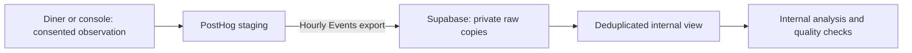

# PostHog to Supabase

## Status

The repository now includes the landing-table migration and permission/duplicate tests. **The hosted migration and scheduled export are not yet activated.** Do not use this document as evidence that Supabase has received PostHog data. Update this status only after the checks below pass.

The diner and console staging sites already send optional shell-view observations to PostHog after consent. Real menu controls and the durable diner-evidence pipeline are separate tickets.

## What this adds



Both kinds of data live in the same Supabase database:

| Location | Purpose | Access |
| --- | --- | --- |
| `app_private` | Authorized restaurant changes, staff membership, receipts and projections | Existing restricted backend role and RLS |
| `analytics_private.posthog_events` | Raw optional observations copied from PostHog | Dedicated exporter can read/append; database operator can inspect |
| `analytics_private.posthog_events_deduplicated` | Exact repeats counted once; conflicting/missing identities excluded | Database operator only; no public API or application grants |

Exporting a row does not make it a verified restaurant fact. There is no owner dashboard endpoint for these tables yet. Developers can use synthetic local fixtures; they do not need the export password.

## Connection setup

1. Apply [the forward migration](../migrations/20261020070000_posthog_exports.sql) through the reviewed migration process. Reuse the existing staging Supabase project; do not provision another database.
2. Create a dedicated `peekaplate_posthog_staging` LOGIN with `INHERIT`, membership in `peekaplate_posthog_export`, and no superuser, role creation, database creation, replication or RLS bypass. Set a unique password privately. Do not reuse the application, `postgres` or service-role credential. Grant database `CONNECT` if not already inherited from PUBLIC.
3. Use the verified Supabase direct or **session-pooler** host/port and database `postgres`. Copy the provider's exact connection settings; the session pooler may require a project-qualified username. Do not guess the host or use Hyperdrive as the exporter destination.
4. In PostHog project `675372`, choose **Data management → Destinations → Postgres batch export**. Create a PostgreSQL connection with **Verify certificate authority and server hostname**. Use the trusted CA bundle or the provider certificate; do not turn verification off to solve a connection error.
5. Choose **Events**, hourly, schema `analytics_private`, table `posthog_events`, and property filter `environment = staging`. Initially include `app_shell_viewed` only. Add `dish_open` / `portion_compare` only when their real callers are implemented and reviewed.
6. Enable the schedule only after the restricted connection succeeds. Backfill only the bounded synthetic test interval required for verification. Record the destination ID, schedule and successful run time without storing credentials.

The precreated Events table needs only `SELECT, INSERT` and schema `USAGE`: the inspected exporter discovers the table before deciding whether to create it. If a provider update demands broader grants, investigate first. Do not grant general schema creation or application access as a shortcut.

## Verify the actual transfer

Generate one consented synthetic observation from each staging site. Record their generated IDs locally, wait for the export run, and match `distinct_id`, event name, surface and environment in Supabase. Verify the scheduled run's status in PostHog; an HTTP capture response alone is insufficient.

Run these queries as an authorized database operator:

```sql
-- Repeated identical copies must not inflate this internal count.
SELECT event, properties->>'surface' AS surface, count(*)
FROM analytics_private.posthog_events_deduplicated
WHERE properties->>'environment' = 'staging'
GROUP BY event, properties->>'surface';

-- Conflicting identity groups need investigation; the view excludes them.
SELECT team_id, uuid, count(*) AS raw_copies
FROM analytics_private.posthog_events
WHERE team_id IS NOT NULL AND uuid IS NOT NULL
GROUP BY team_id, uuid
HAVING count(DISTINCT to_jsonb(posthog_events)) > 1;

SELECT count(*) AS missing_identity_rows
FROM analytics_private.posthog_events
WHERE team_id IS NULL OR uuid IS NULL;
```

Repeat the same synthetic export interval. Raw copies may increase; the deduplicated count must stay unchanged. Test the export login cannot read `app_private.venues`, update/delete landing rows or create schema objects. Confirm `analytics_private` is absent from Supabase's exposed schemas. Never attach raw personal rows or credentials to a PR.

## Operation, cost and recovery

Hourly export means delayed availability, not a one-hour delivery guarantee. Use PostHog's run history for freshness and failures; client event timestamps are not a reliable import-progress cursor. Assign an operator to check failed/overdue runs and retry bounded intervals. The deduplicated view prevents exact retry inflation but does not prove complete delivery.

[PostHog pricing](https://posthog.com/pricing) currently lists one million batch-export rows per month free. This is separate from product-analytics event allowances. Repeated exports/backfills can consume additional rows. The account's actual plan and limits must be verified by its administrator; Supabase storage/compute limits still apply. No paid upgrade is included in this setup.

To stop copying, pause the destination and disable the dedicated LOGIN after checking no run is active. Keep records for investigation; use a reviewed forward change for schema corrections. Before real diner data, approve retention and implement deletion across PostHog, Supabase copies and backups. The existing short-retention proposal is not an automatic deletion job.

Design decision: [ADR 0013](adr/0013-posthog-export-boundary.md). Existing capture behavior: [PostHog setup](posthog.md).
