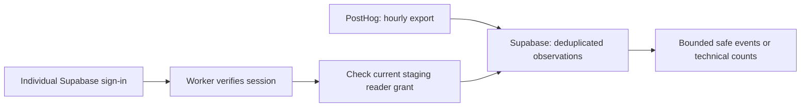

# Team access to staging analytics

## What teammates receive

Use one Cloudflare Worker API URL with an individual Supabase Auth session. A database operator grants that user's UUID access to the staging PostHog project. Repository collaboration, PostHog membership and application access are separate permissions. No shared API password, database login, export password, service-role key or Cloudflare token is distributed to contributors.



These endpoints inspect optional staging observations. Counts describe captured events, not unique diners, menu sessions, orders or owner business metrics. They cannot authorize a restaurant or supply live owner reporting. Do not expose this diagnostic API to restaurant owners. The owner report work remains [S3-DATA-02 / the metric dictionary](implementation_plan.md#6-dashboard-metric-dictionary).

## API contract

Both endpoints require `Authorization: Bearer <your own Supabase access token>`:

| Endpoint | Result |
| --- | --- |
| `GET /team/analytics/events?from=2026-10-20T06:00:00Z&until=2026-10-20T07:00:00Z&limit=50` | Latest safe, deduplicated event records; default 50, maximum 100; `truncated=true` means the window contains more records. Narrow the time range to inspect them. |
| `GET /team/analytics/summary?from=2026-10-20T06:00:00Z&until=2026-10-20T07:00:00Z` | Event counts grouped by event name and diner/console surface, using the same eligible records. |

Use UTC `Z` timestamps with a positive range of at most seven days. The range includes `from` and excludes `until`. Duplicate or unknown query parameters are rejected. The server selects the PostHog project; callers cannot choose actor, role, project or SQL. Responses are `no-store` and identify the source as `posthog_supabase_export`, the environment as `staging`, and freshness as `hourly_export_delay`. `computedAt` is query time, not the last successful import time. A zero count does not prove collection was complete.

An event contains `id`, `event`, `timestamp`, `surface` and an allowlisted `properties` object. Supported properties are `schema_version`, `event_id`, `publication_hash`, `dish_revision_hash`, `displayed_tier`, `manifest_hash` and `availability_version`, when valid and present. No `distinct_id`, person fields, IP, URL or arbitrary properties are returned. Currently hosted capture/export includes only `app_shell_viewed`; `dish_open` and `portion_compare` require real UI callers and an intentional export-filter update.

Errors: 401 means missing/invalid session; 403 means no current reader grant; 400 means invalid query; 503 means configuration, database or response-validation failure. The endpoints return 404 outside explicitly configured local/staging Workers. This API has no data-write or grant-administration endpoint, no arbitrary SQL and no permissive browser CORS. Use a local API client; a future browser inspector must have reviewed origin controls.

## How a teammate uses it

1. An operator creates or invites an individual user in **Supabase Authentication**, then grants that user's UUID below. Each user sets their own credentials. PostHog invitations alone do not create this account.
2. In a local API client such as Postman, sign in with `POST <SUPABASE_URL>/auth/v1/token?grant_type=password`, header `apikey: <project publishable/anon key>` and JSON body containing your own `email` and `password`. Keep this request and the returned session private; do not sync credentials into a public collection or attach results to tickets. Authentication happens directly with Supabase; this Worker does not collect passwords.
3. Use the returned `access_token` as the Bearer token for the two GET requests. When it expires, sign in again or use the normal Supabase refresh flow. Never commit or share access/refresh tokens.
4. Test in PostHog first; the Supabase inspection API will reflect data only after an export succeeds. Check the [export run history and recovery notes](posthog-export.md).

Base URL after the reviewed release is deployed: `https://peekaplate-api-staging.vxkong.workers.dev`. Availability is a separate release check; a PR or successful local test does not activate a hosted endpoint.

## Operator: grants and revocation

Apply migration `20261021130000` through the reviewed process. As the database operator, use the actual Supabase Auth UUID, not an email, GitHub name or browser-supplied identity:

```sql
-- Replace the placeholder UUID with the verified teammate's Auth user ID.
INSERT INTO team_api_private.reader_grant(actor_id, project_id)
VALUES ('00000000-0000-4000-8000-000000000001', 675372)
ON CONFLICT DO NOTHING;

-- Revoke a user's access; the next request checks the database again.
DELETE FROM team_api_private.reader_grant
WHERE actor_id = '00000000-0000-4000-8000-000000000001'
  AND project_id = 675372;
```

Do not run these examples unchanged. Grant only approved internal staging readers. This is project-wide diagnostic access, not restaurant membership. Keep real diner collection disabled until retention/deletion and staff access policies are approved. Revoke departing contributors promptly. A request already reading a snapshot may finish after revocation; later requests are denied. Logout alone does not immediately revoke an already-issued access JWT.

The application runtime receives only `USAGE` on `team_api_private` and `EXECUTE` on one fixed, checked function. It still cannot select raw analytics, enumerate grants or grant itself access. The function is owned by a non-login role with only the required reads and a fixed `pg_catalog` search path. The export account and restaurant-command privileges remain separate. Never add `team_api_private` or `analytics_private` to Supabase's exposed API schemas. Hyperdrive query caching must remain disabled so grant changes are checked on every request.

## GitHub and provider configuration

GitHub Secrets supplies CI/deployment jobs; it is not a vault teammates retrieve passwords from. An admin must create **Settings → Environments → staging**, limit deployments to `main`, and configure available approval controls before enabling deployment. Put the scoped `CLOUDFLARE_API_TOKEN` there as an **environment secret**, and `CLOUDFLARE_ACCOUNT_ID` as an **environment variable**. The existing deployment workflow already reads these names. No Supabase admin, export password or PostHog personal API key is needed by this feature or by routine CI.

Worker configuration uses the existing restricted Hyperdrive binding and Supabase Auth issuer, plus `APP_ENV=staging` and `POSTHOG_PROJECT_ID=675372`. Database credentials stay inside Hyperdrive. The ordinary test suite uses disposable local credentials and signing keys; it needs no hosted secrets.

Share the API URL, Supabase URL, PostHog project link and project publishable/anon key as non-secret setup configuration. Publishable keys do not grant privileged access; per-user login and current reader grants still control these endpoints. Never distribute a Supabase service-role or secret key as frontend configuration. Contributors can develop locally with synthetic fixtures before receiving any hosted access.

On October 21, the authenticated GitHub account had repository write access but no admin permission; no GitHub environments or repository Actions secrets were listed. Environment activation and the Cloudflare deployment token are operator steps, not completed by this source change. No paid plan or new Cloudflare resource is required by this design; actual existing quotas still apply.

## Release acceptance

- Apply the forward migration before deploying the Worker; preserve the existing exporter and restaurant permissions.
- Deploy only the reviewed release under [ADR 0012](adr/0012-main-environment-promotion.md); confirm Hyperdrive query caching is disabled.
- Grant one synthetic user temporarily, verify 200 and bounded redacted results, verify another signed-in user gets 403 and no token gets 401, then revoke the first user and verify 403.
- Confirm production returns 404, PostHog export continues, and raw tables remain inaccessible to public/application roles.
- Record the deployed SHA and evidence. Individual teammate enrollment is a separate access operation; no real teammates are granted access by the migration.

Decision: [ADR 0014](adr/0014-team-analytics-access.md). This does not change the owner-metric suppression threshold or implement S3-DATA-02.
